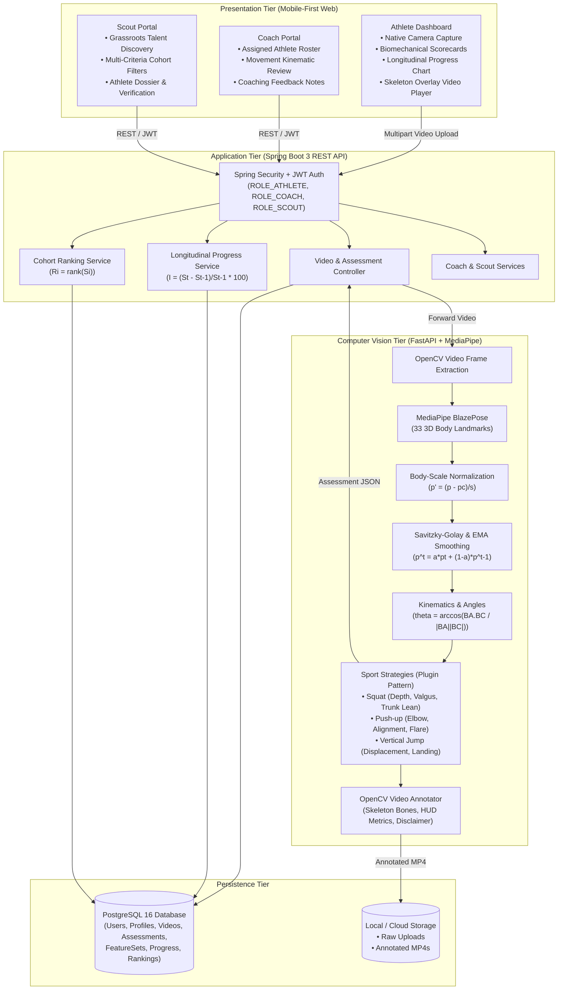
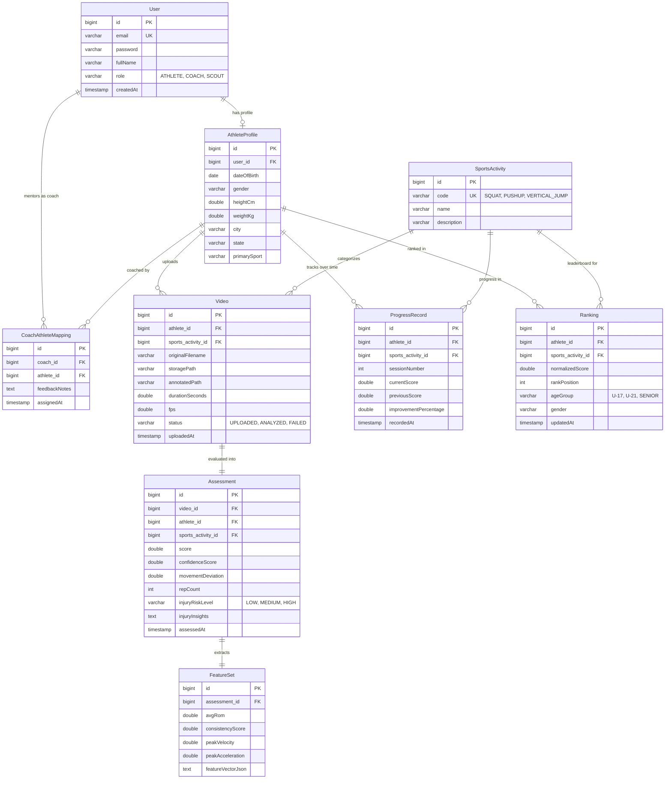

# STRIVE: Accessible Smartphone-Based Sports Talent Assessment & Longitudinal Development

> **Bachelor of Engineering (Computer Engineering) Capstone Project**  
> **Savitribai Phule Pune University (SPPU) • PCCOER Ravet, Academic Year 2026-27**  
> **Authors:** Vedant Patil, Atharva Jadhav, Aditya Gawande, Jatin Kulkarni  
> **Internal Guide:** Mrs. Rutuja Magar • **H.O.D.:** Dr. Vijay A. Kotkar

[](https://www.python.org/)
[](https://adoptium.net/)
[](https://spring.io/projects/spring-boot)
[](https://developers.google.com/mediapipe)
[](#testing)

---

## 1. Problem Statement & Motivation

Athletes in rural and underserved regions often lack access to professional sports academies, certified biomechanical coaches, and expensive multi-camera motion-capture labs. Conventional talent discovery relies on manual, infrequent, subjective observation.

**STRIVE** bridges this opportunity gap:
- An athlete records a movement video using any commodity smartphone camera.
- The computer vision engine tracks 33 anatomical landmarks, normalizes coordinates by torso scale, calculates joint kinematics, and counts repetitions using state machine logic.
- Performance scores ($S = \sum w_i f_i$) and rule-based injury prevention warnings (e.g., knee valgus, excessive trunk lean, elbow flare) are computed in seconds.
- Historical assessments establish longitudinal progress ($I = \frac{S_t - S_{t-1}}{S_{t-1}} \times 100$), enabling coaches and scouts to discover emerging talent objectively.

---

## 2. System Architecture



---

## 3. Entity-Relationship (ER) Diagram



---

## 4. Mathematical Formulations

### 4.1 Joint Angle Calculation (Equation 1.9.1)
The anatomical joint angle formed at vertex $B$ by connecting segments from landmarks $A$ and $C$:
$$\theta = \arccos\left(\frac{(A - B) \cdot (C - B)}{\|A - B\| \, \|C - B\|}\right)$$

### 4.2 Velocity and Acceleration (Equation 1.9.2)
Keypoint kinematics across time frames with sampling step $\Delta t = \frac{1}{\text{fps}}$:
$$v_t = \frac{p_t - p_{t-1}}{\Delta t}, \quad a_t = \frac{v_t - v_{t-1}}{\Delta t}$$

### 4.3 Body-Scale Normalization (Equation 1.9.3)
Removes camera distance and athlete height variance using torso length $s = \|\text{mid\_shoulder} - \text{mid\_hip}\|$:
$$p'_i = \frac{p_i - p_c}{s}$$

### 4.4 Temporal Smoothing (Equation 1.9.4)
Exponential Moving Average and Savitzky-Golay polynomial filtering to suppress keypoint jitter:
$$\hat{p}_t = \alpha p_t + (1 - \alpha) \hat{p}_{t-1}$$

### 4.5 Performance Assessment Scoring (Equation 1.9.6)
Weighted sum of normalized kinematic features:
$$S = \sum_{i=1}^n w_i f_i \quad \text{subject to} \quad \sum_{i=1}^n w_i = 1$$
*(Weights defined in `app/config.py`: ROM 35%, Form Adherence 35%, Consistency 20%, Stability 10%)*

### 4.6 Movement Deviation (Equation 1.9.7)
Mean absolute distance from reference good form:
$$D = \frac{1}{N}\sum_{i=1}^N |x_i - \hat{x}_i|$$

### 4.7 Longitudinal Performance Improvement (Equation 1.9.9)
Percentage score change across consecutive assessment sessions:
$$I = \frac{S_t - S_{t-1}}{S_{t-1}} \times 100$$

### 4.8 Accuracy Evaluation Metrics (Equations 1.9.11 & 1.9.12)
Validation against ground-truth labels:
$$\text{MAE} = \frac{1}{N}\sum_{i=1}^N |y_i - \hat{y}_i|, \quad \text{RMSE} = \sqrt{\frac{1}{N}\sum_{i=1}^N (y_i - \hat{y}_i)^2}$$

---

## 5. Quickstart & Setup Guide

### Option A: Complete System with Docker Compose (Recommended)

```bash
# Clone and enter directory
cd /Users/jatinpadmakarkulkarni/.gemini/antigravity/scratch/strive

# Launch PostgreSQL, CV Service, Spring Boot Backend, and Frontend Nginx
docker-compose up --build
```
- **Frontend Dashboard:** http://localhost:3000
- **Spring Boot Backend:** http://localhost:8080
- **Swagger / OpenAPI Documentation:** http://localhost:8080/swagger-ui.html
- **CV Service FastAPI:** http://localhost:8000/docs

---

### Option B: Local Development Setup

#### 1. Computer Vision Service (`cv-service`)
```bash
cd cv-service
# Activate virtual environment
source venv/bin/activate

# Run PyTest test suite (21 unit tests)
pytest tests/ -v

# Run the end-to-end sample assessment test script
python test_squat_pipeline.py --video ../data/samples/sample_squat.mp4

# Run ground-truth accuracy benchmark evaluation (MAE & RMSE)
python evaluation/evaluate.py

# Launch FastAPI development server
uvicorn app.main:app --host 0.0.0.0 --port 8000 --reload
```

#### 2. Spring Boot 3 Backend (`backend`)
```bash
cd backend
export JAVA_HOME=/Library/Java/JavaVirtualMachines/temurin-21.jdk/Contents/Home

# Run Maven tests (JUnit 5 + Mockito)
./mvnw test

# Run Spring Boot application
./mvnw spring-boot:run
```

#### 3. Mobile-First Frontend (`frontend`)
The frontend is built with vanilla HTML5, CSS3, and JavaScript (Bootstrap 5.3 + Chart.js) with no build tools required. Open `frontend/index.html` in any modern desktop or smartphone browser, or serve it using Python's static server:
```bash
cd frontend
python3 -m http.server 3000
```

---

## 6. Pre-Configured Demo Accounts

| Role | Email | Password | Access Privileges |
| :--- | :--- | :--- | :--- |
| **ATHLETE** | `athlete@strive.org` | `Strive@2026` | Camera capture, scorecards, skeleton replay, longitudinal charts |
| **COACH** | `coach@strive.org` | `Strive@2026` | Assigned athlete monitoring, session inspection, feedback submission |
| **SCOUT** | `scout@strive.org` | `Strive@2026` | Talent search, cohort leaderboards, multi-criteria filtering, dossiers |

---

## 7. Testing & Verification

### PyTest Suite Results (`cv-service`)
```text
tests/test_api.py::test_health_endpoint PASSED                           [  4%]
tests/test_api.py::test_analyze_unsupported_sport PASSED                 [  9%]
tests/test_api.py::test_analyze_invalid_file_extension PASSED            [ 14%]
tests/test_biomechanics.py::test_compute_angle_90_degrees PASSED         [ 19%]
tests/test_biomechanics.py::test_compute_angle_180_straight_line PASSED  [ 23%]
tests/test_biomechanics.py::test_compute_angle_45_degrees PASSED         [ 28%]
tests/test_biomechanics.py::test_compute_angle_3d_coordinates PASSED     [ 33%]
tests/test_biomechanics.py::test_compute_angle_zero_length_fallback PASSED [ 38%]
tests/test_biomechanics.py::test_compute_vector_angle_to_vertical PASSED [ 42%]
tests/test_biomechanics.py::test_compute_kinematics PASSED               [ 47%]
tests/test_biomechanics.py::test_compute_movement_deviation PASSED       [ 52%]
tests/test_normalizer.py::test_body_scale_normalization_scale_invariance PASSED [ 57%]
tests/test_other_sports.py::test_pushup_rep_and_form PASSED              [ 61%]
tests/test_other_sports.py::test_pushup_elbow_flare_rule PASSED          [ 66%]
tests/test_other_sports.py::test_vertical_jump_mechanics PASSED          [ 71%]
tests/test_smoothing.py::test_ema_smoothing_formula PASSED               [ 76%]
tests/test_smoothing.py::test_savgol_smoothing_suppresses_noise PASSED   [ 80%]
tests/test_smoothing.py::test_smoothing_fallback_on_short_sequence PASSED [ 85%]
tests/test_squat.py::test_squat_rep_counting_and_high_score PASSED       [ 90%]
tests/test_squat.py::test_squat_knee_valgus_rule_detection PASSED        [ 95%]
tests/test_squat.py::test_squat_excessive_forward_lean_rule PASSED       [100%]
============================== 21 passed in 3.34s ==============================
```

### Accuracy Evaluation Results (`evaluate.py`)
```text
STRIVE BENCHMARK EVALUATION RESULTS:
--------------------------------------------------
Repetition Counting MAE  (Eq. 1.9.11) : 0.111 reps
Repetition Counting RMSE (Eq. 1.9.12) : 0.333 reps
Performance Score MAE    (Eq. 1.9.11) : 1.411 points
Performance Score RMSE   (Eq. 1.9.12) : 1.747 points
--------------------------------------------------
```

### JUnit 5 Suite Results (`backend`)
```text
[INFO] Running com.strive.service.ProgressServiceTest
[INFO] Tests run: 2, Failures: 0, Errors: 0, Skipped: 0
[INFO] Running com.strive.service.RankingServiceTest
[INFO] Tests run: 1, Failures: 0, Errors: 0, Skipped: 0
[INFO] Running com.strive.service.AuthServiceTest
[INFO] Tests run: 3, Failures: 0, Errors: 0, Skipped: 0
[INFO] ------------------------------------------------------------------------
[INFO] BUILD SUCCESS
[INFO] ------------------------------------------------------------------------
```

---

## 8. Medical & Legal Disclaimer

> **IMPORTANT:** STRIVE biomechanical analysis, joint kinematic calculations, posture deviation indices, and injury-risk insights are designed solely for athletic training optimization, technique screening, and performance development. **STRIVE is not a medical device, nor does it provide medical diagnosis or therapeutic treatment.**
